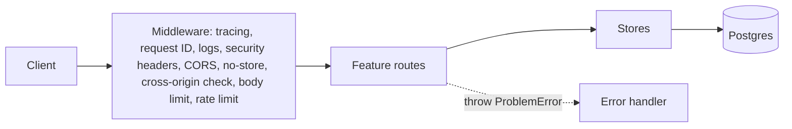

# Architecture

| Layer       | Path                       | Does                                        | Must not                                       |
| ----------- | -------------------------- | ------------------------------------------- | ---------------------------------------------- |
| Entry point | `src/index.ts`             | Starts the server, handles shutdown         | Hold business logic                            |
| App         | `src/app.ts`               | Wires middleware and routes                 | Touch the database directly                    |
| Features    | `src/features/*/routes.ts` | Define the HTTP contract and validate input | Import another feature, except auth middleware |
| Stores      | `src/features/*/store.ts`  | Run queries                                 | Import Hono                                    |
| Platform    | `src/platform/`            | Cross-cutting HTTP concerns                 | Import a feature                               |
| Database    | `src/db/`                  | Schema and connections                      | Import anything above it                       |

`test/unit/architecture.test.ts` fails the build when a dependency breaks these rules.

## Key behaviors

- **Contract:** route definitions generate `openapi.json`, and a test fails if the committed file is out of date. Chained routes also produce `AppType` for the typed client.
- **Errors:** every failure is RFC 9457 Problem Details. Unexpected errors are logged and recorded on the trace, and the client only sees a request ID.
- **Sessions:** login returns an opaque token in the body, or sets it in an `HttpOnly` `__Host-session` cookie for a browser app on the same origin. An `Authorization` header always wins over the cookie. See [ADR 006](decisions/006-cookie-sessions-for-same-origin-browser-apps.md).
- **Cross-origin writes:** a `/v1` request that isn't `GET`, `HEAD`, or `OPTIONS` gets 403 if `Sec-Fetch-Site` or `Origin` shows it came from another site, unless the origin is in `CORS_ORIGINS`.
- **Authorization:** every note query filters by the caller's user ID, so another user's note looks like it doesn't exist.
- **Concurrency:** updates need an `If-Match` version, and the check happens inside the `UPDATE` statement.
- **Idempotency:** keys are scoped to the user and the endpoint, such as `POST /v1/notes`. The key and the note are written in one transaction. A concurrent duplicate waits for the first to commit, then replays it.
- **Rate limits:** a global and an auth limit per client network, and a failed-login limit per account, all counted in Postgres. See [Rate limits](operations.md#rate-limits).
- **Contract coverage:** `src/platform/openapi.ts` adds the problems and headers that middleware returns to every operation, so routes declare only their own.
- **Database roles:** the API connects as `api_app`, which can read and write rows but can't change the schema. Migrations run as `api_owner`.
